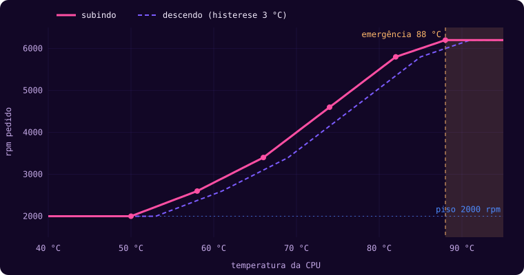
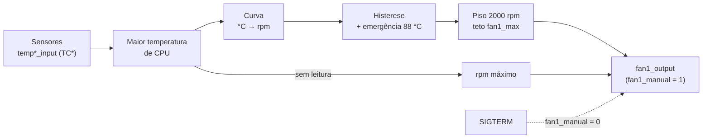

<p align="center">
  
</p>

<p align="center">
  <a href="https://github.com/Dimasaas/breeze/actions/workflows/ci.yml"></a>
  
  
  
  
</p>

# Breeze

**a ventoinha inteligente do MacBook que virou servidor**

Breeze é um daemon de ventoinha para **MacBook rodando Linux**, pelo driver `applesmc`. Lê as temperaturas, aplica uma curva configurável com histerese e controla o rpm direto pelo sysfs. Python 3.10+, **só a biblioteca padrão**.

## Por que existe

Um MacBook Pro 2012 virou o servidor do escritório: tampa fechada, ligado 24 horas, quase sempre ocioso e, de vez em quando, com a CPU a 100%. O controle automático do SMC no Linux é conservador para uma máquina assim: deixa a ventoinha alta sem necessidade e demora a reagir quando a carga chega de repente. As alternativas prontas funcionam, mas eu queria três coisas que elas não davam juntas:

- uma **curva em JSON** que eu entendo e posso mudar sem recompilar nada;
- **histerese de verdade**, para a ventoinha não ficar subindo e descendo a cada oscilação de 1 °C;
- **falhar para o lado seguro**: sensor com defeito, temperatura alta demais ou processo morto nunca podem deixar a ventoinha parada.

O resultado é um serviço pequeno (cerca de 400 linhas), com testes que rodam sem MacBook nenhum, porque todo o acesso ao hardware passa por uma classe que aceita uma raiz alternativa.

## A curva

Temperatura da CPU para rpm, com interpolação linear entre os pontos. O gráfico abaixo é gerado por `scripts/gerar_curva_svg.py` a partir da configuração padrão.

<p align="center">
  
</p>

| Parâmetro | Padrão | O que faz |
|---|---|---|
| `curva` | 50 °C → 2000 rpm … 88 °C → 6200 rpm | pontos `[°C, rpm]`; temperaturas crescentes e rpm que nunca cai |
| `piso_rpm` | 2000 | o daemon nunca pede menos que isso |
| `emergencia_c` | 88 | a partir daqui, rpm máximo (aceita de 60 a 88) |
| `histerese_c` | 3 | quanto a temperatura precisa cair para a ventoinha desacelerar |
| `intervalo_s` | 2 | tempo entre leituras |

Regras de decisão:

- **Subindo**, o rpm acompanha a curva na hora.
- **Descendo**, o rpm só cai depois que a temperatura recua mais de `histerese_c` abaixo do ponto onde ele subiu. Dentro dessa banda ele fica parado.
- **Emergência**: com 88 °C ou mais, rpm máximo (o `fan1_max` do hardware). A trava só solta abaixo de 84 °C.
- **Sensor falhou** (arquivo sumiu, valor ilegível ou fora de 5–120 °C): rpm máximo, e o log avisa.
- **Saída** (SIGTERM ou SIGINT): `fan1_manual = 0`, e o SMC volta a controlar sozinho.

## Como funciona



| Módulo | Papel |
|---|---|
| `sysfs.py` | classe `Applesmc(raiz=...)`: única porta para o hardware |
| `curva.py` | configuração, validação e interpolação |
| `controle.py` | histerese, emergência e falha de sensor (lógica pura, sem I/O) |
| `daemon.py` | laço, escrita, tratamento de sinais e devolução ao automático |
| `simulador.py` | árvore sysfs falsa e modelo térmico para testes e demonstrações |

Uma observação de hardware: em alguns modelos o `fan1_min` informado pelo driver é mais alto do que o piso que o SMC realmente aceita em modo manual. Por isso o piso é uma opção (`piso_rpm`) e não é lido do sysfs. Teste no seu aparelho antes de baixar além de 2000.

## Instalação

Requisitos: MacBook com o módulo `applesmc` carregado (confira com `ls /sys/devices/platform/applesmc.768/`), Python 3.10+ e systemd.

```bash
git clone https://github.com/Dimasaas/breeze.git
cd breeze

# 1. veja o que ele faria, sem escrever nada
python3 -m breeze --simular --ciclos 5

# 2. instale o serviço
sudo ./instalar.sh

# acompanhar
journalctl -fu breeze
```

O `instalar.sh` copia o pacote para `/opt/breeze`, instala `/etc/breeze.json` (sem sobrescrever uma configuração válida que já exista), instala a unit, desliga o `mbpfan` se ele estiver ativo e sobe o serviço. **Se o serviço não ficar ativo em 4 segundos, ele desfaz tudo e devolve a ventoinha ao automático.** Para remover: `sudo ./desinstalar.sh`.

### Linha de comando

```text
python3 -m breeze [--config ARQ] [--simular] [--ciclos N] [--raiz DIR]
python3 -m breeze --validar ARQ     # confere um JSON e sai (0 = ok)
python3 -m breeze --padrao          # imprime a configuração padrão
```

`--simular` lê os sensores reais, imprime a decisão e **não escreve em nada** (a classe de acesso é aberta em modo somente leitura). Exemplo de saída:

```text
2026-11-25 10:32:01 66.0 °C -> 3400 rpm (curva)
2026-11-25 10:32:03 64.5 °C -> 3400 rpm (histerese)
```

`--raiz` aponta para uma árvore falsa, útil para testar a configuração em qualquer máquina.

## Segurança da unit

O serviço roda como root (o sysfs do applesmc é de root), mas com o mínimo possível em volta:

| Diretiva | Efeito |
|---|---|
| `ProtectSystem=strict` + `ReadWritePaths=/sys/devices/platform/applesmc.768` | o sistema inteiro fica somente leitura; só o diretório do driver é gravável |
| `NoNewPrivileges`, `CapabilityBoundingSet=` (vazio) | sem elevar privilégio e sem nenhuma capability |
| `PrivateNetwork`, `PrivateTmp`, `PrivateDevices`, `ProtectHome` | sem rede, sem `/tmp` compartilhado, sem dispositivos, sem home |
| `ProtectKernelModules/Logs`, `ProtectControlGroups`, `ProtectClock` | sem mexer em módulos, logs do kernel, cgroups ou relógio |
| `SystemCallFilter=@system-service` (menos `@privileged @resources`) | só as chamadas de sistema que um serviço comum usa |
| `MemoryDenyWriteExecute`, `RestrictNamespaces`, `LockPersonality` | endurecimento geral do processo |
| `ExecStopPost` | se o processo morrer à força, ainda assim devolve `fan1_manual = 0` |

Duas armadilhas conhecidas: **não** use `ProtectKernelTunables=yes` (deixa o `/sys` somente leitura e o daemon deixa de conseguir escrever), e o serviço conflita de propósito com o `mbpfan` (`Conflicts=`), porque só um programa pode mandar na ventoinha.

## Testes

```bash
python3 -m unittest discover -s tests -t . -v     # ou: pytest
```

Os testes usam uma árvore sysfs falsa num diretório temporário e um **simulador de aquecimento e resfriamento**: a CPU dissipa watts conforme a carga, o dissipador perde calor conforme o rpm que o daemon escreveu, e o laço fecha. Isso verifica, entre outras coisas, que:

- com carga alta a temperatura estabiliza abaixo de 88 °C;
- quando a carga cessa, a ventoinha volta ao piso de 2000 rpm;
- uma carga oscilando não faz o rpm "caçar" valores;
- se os sensores somem no meio da execução, o pedido vai para o máximo;
- o SIGTERM encerra o laço e deixa `fan1_manual = 0`, inclusive depois de erro fatal;
- `--simular` não escreve um byte sequer.

A CI roda tudo em Python 3.10 e 3.12.

## Licença

Uso livre para **estudo, pesquisa e projetos pessoais ou sem fins comerciais**, sob a [PolyForm Noncommercial 1.0.0](LICENSE). Uso comercial só com autorização do autor.

---

## 🇺🇸 TL;DR

A small, dependency-free Python daemon that controls the fan of an Apple MacBook running Linux through the `applesmc` sysfs interface. It maps CPU temperature to RPM with a JSON-configurable curve, adds hysteresis so the fan does not hunt, enforces a 2000 RPM floor, and jumps to full speed at 88 °C. If the sensor fails it also goes to full speed, and on SIGTERM it hands control back to the firmware (`fan1_manual = 0`). `--simular` prints decisions without writing anything. It ships with a hardened systemd unit, install/uninstall scripts and tests that run against a fake sysfs tree with a thermal simulator, so no MacBook is needed to develop on it. Licensed for noncommercial use (PolyForm Noncommercial 1.0.0).

```bash
python3 -m breeze --simular --ciclos 5   # dry run
sudo ./instalar.sh                                  # install as a service
```
